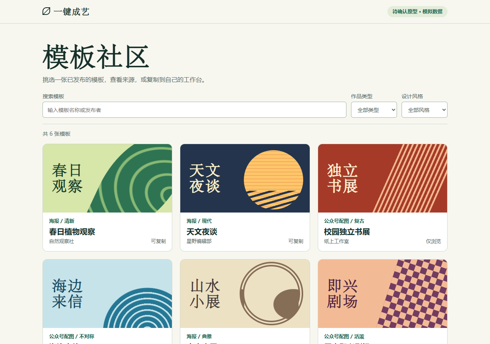

# 模板社区 · 待确认原型

[下载交互原型](index.html) 后用浏览器打开即可。在 GitHub 的文件页点击右上角 **Download raw file** 可保存 HTML。页面完全离线运行，使用六张虚构模板；副本保留在本次打开的页面内，刷新即清空。

## 用三分钟走一遍

1. 搜索“纸上”，或同时选择“公众号配图”和“复古”，打开《校园独立书展》。可以查看来源和版本，复制按钮显示“仅可浏览”。
2. 清除搜索及筛选，打开《春日植物观察》，点击“复制到我的工作台”，改名并保存。返回列表重新打开，原版名称与版本保留，可以继续编辑刚才的副本。
3. 展开“原型演示设置”，切换成游客后再打开一个可复制模板，体验登录提示。也可以模拟列表加载失败，重试后原筛选条件保留。

## 请确认

| 问题 | 当前演示的选项 |
| --- | --- |
| 展示哪些模板？ | 展示审核通过的发布版本，系统内置模板仍从创作页选择。 |
| 谁可以复制？ | 游客可浏览，登录成员可复制；发布者可限制为仅浏览。 |
| 用户怎样查找模板？ | 按名称或公开署名搜索，组合筛选作品类型和风格。 |
| 点击“复制使用”后想做什么？ | 目前进入私有模板工作台修改版式。另一种选择是直接去创作页，用该模板填写自己的作品文案。 |
| 本轮怎样验收？ | 浏览、筛选、查看来源、创建私有副本、只读和失败反馈。 |

## 接口讨论

Demo 现有的 [发布模板和草稿接口](../../backend/app/api/template_workbench_v2.py) 提供发布列表与详情，以及通过来源模板创建私有草稿的能力。列表已支持偏移分页。社区若采用上表方案，还需约定筛选与总数的计算顺序、公开署名、复制权限和工作台如何按新草稿 ID 打开。复制时由服务端校验身份、来源状态和归属；版式副本只引用允许公开的内容。接口概览见 [API 文档](../API.md)。

原型的浏览器验证覆盖 1280 × 900 和 390 × 844 两种尺寸，包括组合筛选、空结果、加载失败重试、只读状态、游客模拟登录、复制改名与刷新清空。真实接口联调待需求确认后开展。
